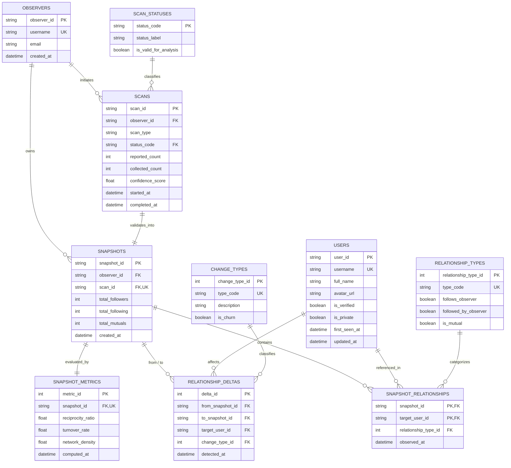

# Database Normalization: Instagram Network Observatory (Brutus)

This document formalizes the relational database architecture for **Brutus** (an Instagram Network Observatory), detailing the systematic transformation of social graph, scan audit, and time-series snapshot data through the normal forms: **UNF $\to$ 1NF $\to$ 2NF $\to$ 3NF $\to$ BCNF**.

---

## 1. Domain Overview & Data Requirements

Brutus captures, audits, and analyzes personal Instagram social network graphs over time. Unlike ephemeral follower-checker scripts, Brutus treats social graphs as time-series datasets with data quality tracking, snapshot differencing, and graph analytics.

### Key Domain Entities

1. **Observers (`Observer`):** The local user/account running the observation tool.
2. **Scans (`Scan`):** Execution events of the DOM crawler, recording data extraction integrity metrics (reported count, collected count, duplicates, missing items, confidence rating).
3. **Snapshots (`Snapshot`):** Validated point-in-time frozen states of the observer's network graph.
4. **Users / Profiles (`User`):** Discovered Instagram accounts connected to the observer or present in the graph.
5. **Relationships / Edges (`Relationship`):** Directed network connections between the observer and target accounts (`mutual`, `following_only`, `follower_only`).
6. **Relationship Deltas (`RelationshipDelta`):** Churn records between sequential snapshots (`new_follower`, `lost_follower`, `new_following`, `unfollowed`, `became_mutual`, `lost_mutual`).
7. **Graph Analytics (`NetworkMetric`):** Macro-level topological metrics for each snapshot (reciprocity rate, graph density, turnover rate).

---

## 2. Unnormalized Form (UNF)

In an unnormalized architecture (such as a flat JSON dump, CSV export, or single spreadsheet tab), all observer metadata, scan telemetry, user profiles, relationship arrays, and historical logs are crammed into a single bloated structure with repeating groups and non-atomic fields.

### 2.1 UNF Representation

```
UNF_Network_Observation(
    observer_id,
    observer_username,
    observer_email,
    scan_id,
    scan_timestamp,
    scan_type,
    scan_status_code,
    scan_status_description,
    reported_count,
    collected_count,
    confidence_score,
    snapshot_id,
    snapshot_timestamp,
    reciprocity_ratio,
    network_density,
    {
        target_user_id,
        target_username,
        target_full_name,
        target_avatar_url,
        is_verified,
        is_private,
        relationship_type_code,
        relationship_type_name,
        is_mutual,
        follows_observer,
        followed_by_observer,
        observed_at
    },
    {
        change_id,
        change_user_id,
        change_type_code,
        change_type_label,
        detected_at
    }
)
```

### 2.2 Sample UNF Data Record

| Attribute                         | Record Value                                                                                                                                                                                                                                                                                                     |
| --------------------------------- | ---------------------------------------------------------------------------------------------------------------------------------------------------------------------------------------------------------------------------------------------------------------------------------------------------------------- |
| `observer_id`                     | `obs_101`                                                                                                                                                                                                                                                                                                        |
| `observer_username`               | `alex_dev`                                                                                                                                                                                                                                                                                                       |
| `observer_email`                  | `alex@example.com`                                                                                                                                                                                                                                                                                               |
| `scan_id`                         | `scn_2026_001`                                                                                                                                                                                                                                                                                                   |
| `scan_timestamp`                  | `2026-11-01 10:00:00`                                                                                                                                                                                                                                                                                            |
| `scan_status`                     | `COMPLETE: Scan matched DOM counter with 100% integrity`                                                                                                                                                                                                                                                         |
| `reported_count`                  | `3`                                                                                                                                                                                                                                                                                                              |
| `collected_count`                 | `3`                                                                                                                                                                                                                                                                                                              |
| `snapshot_id`                     | `snp_2026_11_01`                                                                                                                                                                                                                                                                                                 |
| **`target_users` (Nested Array)** | `[ { uid: 881, user: "alice", name: "Alice M", verified: true, rel: "MUTUAL", mutual: true }, { uid: 882, user: "bob_coder", name: "Bob C", verified: false, rel: "FOLLOWING_ONLY", mutual: false }, { uid: 883, user: "charlie_art", name: "Charlie", verified: false, rel: "FOLLOWER_ONLY", mutual: false } ]` |
| **`deltas` (Nested Array)**       | `[ { chg_id: 1, user: 882, type: "LOST_MUTUAL", at: "2026-11-01 10:00:00" } ]`                                                                                                                                                                                                                                   |

### 2.3 Anomalies in UNF

- **Repeating Groups:** An arbitrary number of target users and deltas are nested in arrays or comma-delimited strings within a single observation record.
- **Insertion Anomaly:** A new Instagram user profile cannot be stored without recording an active scan or snapshot.
- **Update Anomaly:** If `alice` changes her display name to "Alice Miller", every past scan record containing her inside nested arrays must be searched and modified.
- **Deletion Anomaly:** Deleting a corrupted scan run purges all cached user profile data for accounts that only appeared in that single scan.

---

## 3. First Normal Form (1NF)

### 3.1 Definition & Requirements

A relation is in **First Normal Form (1NF)** if and only if:

1. Every attribute contains only **atomic** (indivisible) values.
2. There are no **repeating groups** or multi-valued attributes (arrays/nested tables are flattened).
3. Each record is uniquely identified by a defined **Primary Key**.

### 3.2 Transformation to 1NF

To eliminate nested arrays, we flatten the relation. Each row represents a single observed target user in a specific scan/snapshot. The delta events are separated or represented with atomic columns.

```
Observation_1NF(
    observer_id,
    observer_username,
    observer_email,
    scan_id,
    scan_timestamp,
    scan_type,
    scan_status_code,
    scan_status_description,
    reported_count,
    collected_count,
    confidence_score,
    snapshot_id,
    snapshot_timestamp,
    reciprocity_ratio,
    network_density,
    target_user_id,
    target_username,
    target_full_name,
    target_avatar_url,
    is_verified,
    is_private,
    relationship_type_code,
    relationship_type_name,
    is_mutual,
    follows_observer,
    followed_by_observer,
    observed_at
)
```

**Composite Primary Key:**
$$\text{PK} = \{\underline{\text{snapshot\_id}}, \underline{\text{target\_user\_id}}\}$$

_(Assuming one snapshot per scan run, or alternately $\{\text{scan\_id}, \text{target\_user\_id}\}$)._

### 3.3 1NF Table Instance

| snapshot_id | target_user_id | observer_id | observer_username | scan_id  | reported_count | target_username | target_full_name | is_verified | rel_type_code | rel_type_name  | is_mutual |
| ----------- | -------------- | ----------- | ----------------- | -------- | -------------- | --------------- | ---------------- | ----------- | ------------- | -------------- | --------- |
| `snp_01`    | `881`          | `obs_101`   | `alex_dev`        | `scn_01` | 3              | `alice`         | Alice M          | TRUE        | `MUT`         | Mutual         | TRUE      |
| `snp_01`    | `882`          | `obs_101`   | `alex_dev`        | `scn_01` | 3              | `bob_coder`     | Bob C            | FALSE       | `FNG`         | Following Only | FALSE     |
| `snp_01`    | `883`          | `obs_101`   | `alex_dev`        | `scn_01` | 3              | `charlie_art`   | Charlie          | FALSE       | `FLR`         | Follower Only  | FALSE     |
| `snp_02`    | `881`          | `obs_101`   | `alex_dev`        | `scn_02` | 3              | `alice`         | Alice M          | TRUE        | `MUT`         | Mutual         | TRUE      |

### 3.4 Functional Dependencies in 1NF

- $\text{FD}_1$: $\{\text{snapshot\_id}, \text{target\_user\_id}\} \to \{\text{relationship\_type\_code}, \text{relationship\_type\_name}, \text{is\_mutual}, \text{follows\_observer}, \text{followed\_by\_observer}, \text{observed\_at}\}$
- $\text{FD}_2$: $\text{snapshot\_id} \to \{\text{observer\_id}, \text{observer\_username}, \text{observer\_email}, \text{scan\_id}, \text{scan\_timestamp}, \text{scan\_type}, \text{scan\_status\_code}, \text{scan\_status\_description}, \text{reported\_count}, \text{collected\_count}, \text{confidence\_score}, \text{snapshot\_timestamp}, \text{reciprocity\_ratio}, \text{network\_density}\}$
- $\text{FD}_3$: $\text{target\_user\_id} \to \{\text{target\_username}, \text{target\_full\_name}, \text{target\_avatar\_url}, \text{is\_verified}, \text{is\_private}\}$

### 3.5 Remaining Vulnerabilities in 1NF

- **Partial Functional Dependencies:** $\text{FD}_2$ and $\text{FD}_3$ depend on only _part_ of the composite primary key ($\text{snapshot\_id}$ alone or $\text{target\_user\_id}$ alone).
- **Data Redundancy:** For an account with 2,000 followers, the observer's information, scan metrics, and snapshot totals are duplicated 2,000 times in the table.
- **Update Anomaly:** Updating `alex_dev`'s email requires modifying every row in every snapshot.
- **Insertion Anomaly:** We cannot record a discovered user profile without attaching them to an existing snapshot.

---

## 4. Second Normal Form (2NF)

### 4.1 Definition & Requirements

A relation is in **Second Normal Form (2NF)** if and only if:

1. It is in **1NF**.
2. There are **no partial dependencies**: every non-prime attribute is **fully functionally dependent** on the entire primary key.

If a relation has a single-attribute primary key, it is automatically in 2NF once it satisfies 1NF. For relations with composite primary keys, any attribute that depends on only a subset of the primary key must be factored out into a separate relation.

### 4.2 Eliminating Partial Dependencies

From our 1NF dependencies:

- Attributes depending purely on $\text{target\_user\_id}$ ($\text{FD}_3$) are moved to a `Users` relation.
- Attributes depending purely on $\text{snapshot\_id}$ ($\text{FD}_2$) are moved to a `Snapshots` relation.
- Attributes depending on the entire composite key $\{\text{snapshot\_id}, \text{target\_user\_id}\}$ remain in `Snapshot_Relationships`.

### 4.3 2NF Decomposed Relations

#### 1. `Users_2NF`

Stores profile information keyed solely by `target_user_id`.

- **Primary Key:** `user_id`
- **Schema:**
  ```sql
  Users_2NF(
      user_id (PK),
      username,
      full_name,
      avatar_url,
      is_verified,
      is_private
  )
  ```
- **Dependencies:**
  $$\text{user\_id} \to \{\text{username}, \text{full\_name}, \text{avatar\_url}, \text{is\_verified}, \text{is\_private}\}$$

#### 2. `Snapshots_2NF`

Stores scan and snapshot execution details keyed solely by `snapshot_id`.

- **Primary Key:** `snapshot_id`
- **Schema:**
  ```sql
  Snapshots_2NF(
      snapshot_id (PK),
      snapshot_timestamp,
      observer_id,
      observer_username,
      observer_email,
      scan_id,
      scan_timestamp,
      scan_type,
      scan_status_code,
      scan_status_description,
      reported_count,
      collected_count,
      confidence_score,
      reciprocity_ratio,
      network_density
  )
  ```
- **Dependencies:**
  $$\text{snapshot\_id} \to \{\text{snapshot\_timestamp}, \text{observer\_id}, \dots, \text{network\_density}\}$$

#### 3. `Snapshot_Relationships_2NF`

Associative entity preserving the social graph edges at that specific snapshot.

- **Primary Key:** `(snapshot_id, target_user_id)`
- **Foreign Keys:**
  - `snapshot_id` $\to$ `Snapshots_2NF(snapshot_id)`
  - `target_user_id` $\to$ `Users_2NF(user_id)`
- **Schema:**
  ```sql
  Snapshot_Relationships_2NF(
      snapshot_id (PK, FK),
      target_user_id (PK, FK),
      relationship_type_code,
      relationship_type_name,
      is_mutual,
      follows_observer,
      followed_by_observer,
      observed_at
  )
  ```
- **Dependencies:**
  $$\{\text{snapshot\_id}, \text{target\_user\_id}\} \to \{\text{relationship\_type\_code}, \text{relationship\_type\_name}, \text{is\_mutual}, \text{follows\_observer}, \text{followed\_by\_observer}, \text{observed\_at}\}$$

### 4.4 Remaining Vulnerabilities in 2NF

While partial dependencies are eliminated, **transitive dependencies** remain:

1. In `Snapshots_2NF`:
   - $\text{snapshot\_id} \to \text{observer\_id}$ and $\text{observer\_id} \to \{\text{observer\_username}, \text{observer\_email}\}$
   - $\text{snapshot\_id} \to \text{scan\_id}$ and $\text{scan\_id} \to \{\text{scan\_timestamp}, \text{scan\_type}, \text{scan\_status\_code}, \dots\}$
   - $\text{scan\_status\_code} \to \text{scan\_status\_description}$
2. In `Snapshot_Relationships_2NF`:
   - $\{\text{snapshot\_id}, \text{target\_user\_id}\} \to \text{relationship\_type\_code}$
   - $\text{relationship\_type\_code} \to \{\text{relationship\_type\_name}, \text{is\_mutual}, \text{follows\_observer}, \text{followed\_by\_observer}\}$

---

## 5. Third Normal Form (3NF)

### 5.1 Definition & Requirements

A relation is in **Third Normal Form (3NF)** if and only if:

1. It is in **2NF**.
2. There are **no transitive dependencies** for non-prime attributes.
   _Formally:_ For every non-trivial functional dependency $X \to Y$, either:
   - $X$ is a **Superkey**, OR
   - $Y$ is a **Prime Attribute** (part of a candidate key).

In colloquial terms: _"Every non-key attribute must provide a fact about the key, the whole key, and nothing but the key (so help me Codd)."_

### 5.2 Identifying & Eliminating Transitive Dependencies

#### A. In `Snapshots_2NF`:

- **Transitive Dependency 1 (Observer):**
  $$\text{snapshot\_id} \to \text{observer\_id} \to \{\text{observer\_username}, \text{observer\_email}\}$$
  _Resolution:_ Create separate `Observers` relation.
- **Transitive Dependency 2 (Scan Telemetry):**
  $$\text{snapshot\_id} \to \text{scan\_id} \to \{\text{scan\_timestamp}, \text{scan\_type}, \text{scan\_status\_code}, \text{reported\_count}, \text{collected\_count}, \text{confidence\_score}\}$$
  _Resolution:_ Separate `Scans` from `Snapshots`. A scan is the operational extraction event; a snapshot is the accepted graph state.
- **Transitive Dependency 3 (Scan Status):**
  $$\text{scan\_id} \to \text{scan\_status\_code} \to \text{scan\_status\_description}$$
  _Resolution:_ Create lookup table `Scan_Statuses`.
- **Transitive Dependency 4 (Derived Analytics):**
  $$\text{snapshot\_id} \to \{\text{reciprocity\_ratio}, \text{network\_density}\}$$
  _Resolution:_ Separate into a dedicated `Snapshot_Metrics` relation.

#### B. In `Snapshot_Relationships_2NF`:

- **Transitive Dependency (Relationship Classification):**
  $$\{\text{snapshot\_id}, \text{target\_user\_id}\} \to \text{relationship\_type\_id} \to \{\text{type\_code}, \text{type\_label}, \text{is\_mutual}, \text{follows\_observer}, \text{followed\_by\_observer}\}$$
  _Resolution:_ Create a canonical lookup table `Relationship_Types`.

### 5.3 3NF Decomposed Schema

#### 1. `Observers`

```sql
CREATE TABLE Observers (
    observer_id VARCHAR(64) PRIMARY KEY,
    username VARCHAR(64) NOT NULL UNIQUE,
    email VARCHAR(255) NOT NULL,
    created_at TIMESTAMP NOT NULL DEFAULT CURRENT_TIMESTAMP
);
```

#### 2. `Scan_Statuses`

```sql
CREATE TABLE Scan_Statuses (
    status_code VARCHAR(32) PRIMARY KEY,
    status_label VARCHAR(64) NOT NULL,
    description TEXT,
    is_valid_for_analysis BOOLEAN NOT NULL DEFAULT FALSE
);
```

#### 3. `Scans`

Tracks DOM pagination and validation checkpoints.

```sql
CREATE TABLE Scans (
    scan_id VARCHAR(64) PRIMARY KEY,
    observer_id VARCHAR(64) NOT NULL,
    scan_type VARCHAR(32) NOT NULL CHECK (scan_type IN ('FOLLOWERS', 'FOLLOWING', 'FULL')),
    status_code VARCHAR(32) NOT NULL,
    reported_count INTEGER NOT NULL CHECK (reported_count >= 0),
    collected_count INTEGER NOT NULL CHECK (collected_count >= 0),
    duplicate_count INTEGER NOT NULL DEFAULT 0,
    error_count INTEGER NOT NULL DEFAULT 0,
    confidence_score REAL NOT NULL CHECK (confidence_score BETWEEN 0.0 AND 1.0),
    started_at TIMESTAMP NOT NULL,
    completed_at TIMESTAMP,
    FOREIGN KEY (observer_id) REFERENCES Observers(observer_id),
    FOREIGN KEY (status_code) REFERENCES Scan_Statuses(status_code)
);
```

#### 4. `Snapshots`

A validated social graph baseline tied to a clean scan.

```sql
CREATE TABLE Snapshots (
    snapshot_id VARCHAR(64) PRIMARY KEY,
    observer_id VARCHAR(64) NOT NULL,
    scan_id VARCHAR(64) NOT NULL UNIQUE,
    total_followers INTEGER NOT NULL DEFAULT 0,
    total_following INTEGER NOT NULL DEFAULT 0,
    total_mutuals INTEGER NOT NULL DEFAULT 0,
    created_at TIMESTAMP NOT NULL DEFAULT CURRENT_TIMESTAMP,
    FOREIGN KEY (observer_id) REFERENCES Observers(observer_id),
    FOREIGN KEY (scan_id) REFERENCES Scans(scan_id)
);
```

#### 5. `Users`

Canonical directory of Instagram accounts observed in the graph.

```sql
CREATE TABLE Users (
    user_id VARCHAR(64) PRIMARY KEY,
    username VARCHAR(64) NOT NULL UNIQUE,
    full_name VARCHAR(128),
    avatar_url TEXT,
    is_verified BOOLEAN NOT NULL DEFAULT FALSE,
    is_private BOOLEAN NOT NULL DEFAULT FALSE,
    first_seen_at TIMESTAMP NOT NULL DEFAULT CURRENT_TIMESTAMP,
    updated_at TIMESTAMP NOT NULL DEFAULT CURRENT_TIMESTAMP
);
```

#### 6. `Relationship_Types`

Deterministic lookup for graph edge taxonomy.

```sql
CREATE TABLE Relationship_Types (
    relationship_type_id INTEGER PRIMARY KEY,
    type_code VARCHAR(32) NOT NULL UNIQUE,
    type_label VARCHAR(64) NOT NULL,
    follows_observer BOOLEAN NOT NULL,
    followed_by_observer BOOLEAN NOT NULL,
    is_mutual BOOLEAN NOT NULL
);
```

#### 7. `Snapshot_Relationships`

The normalized edge table mapping users into snapshot states.

```sql
CREATE TABLE Snapshot_Relationships (
    snapshot_id VARCHAR(64) NOT NULL,
    target_user_id VARCHAR(64) NOT NULL,
    relationship_type_id INTEGER NOT NULL,
    observed_at TIMESTAMP NOT NULL DEFAULT CURRENT_TIMESTAMP,
    PRIMARY KEY (snapshot_id, target_user_id),
    FOREIGN KEY (snapshot_id) REFERENCES Snapshots(snapshot_id) ON DELETE CASCADE,
    FOREIGN KEY (target_user_id) REFERENCES Users(user_id),
    FOREIGN KEY (relationship_type_id) REFERENCES Relationship_Types(relationship_type_id)
);
```

#### 8. `Change_Types` & `Relationship_Deltas`

Captures historical diffs between consecutive snapshots ($\Delta(S_{t-1}, S_t)$).

```sql
CREATE TABLE Change_Types (
    change_type_id INTEGER PRIMARY KEY,
    type_code VARCHAR(32) NOT NULL UNIQUE,
    description VARCHAR(128) NOT NULL,
    is_churn BOOLEAN NOT NULL DEFAULT FALSE
);

CREATE TABLE Relationship_Deltas (
    delta_id INTEGER PRIMARY KEY AUTOINCREMENT,
    from_snapshot_id VARCHAR(64) NOT NULL,
    to_snapshot_id VARCHAR(64) NOT NULL,
    target_user_id VARCHAR(64) NOT NULL,
    change_type_id INTEGER NOT NULL,
    detected_at TIMESTAMP NOT NULL DEFAULT CURRENT_TIMESTAMP,
    FOREIGN KEY (from_snapshot_id) REFERENCES Snapshots(snapshot_id),
    FOREIGN KEY (to_snapshot_id) REFERENCES Snapshots(snapshot_id),
    FOREIGN KEY (target_user_id) REFERENCES Users(user_id),
    FOREIGN KEY (change_type_id) REFERENCES Change_Types(change_type_id),
    UNIQUE (from_snapshot_id, to_snapshot_id, target_user_id, change_type_id)
);
```

#### 9. `Snapshot_Metrics`

Stores computed topological characteristics for the network state.

```sql
CREATE TABLE Snapshot_Metrics (
    metric_id INTEGER PRIMARY KEY AUTOINCREMENT,
    snapshot_id VARCHAR(64) NOT NULL UNIQUE,
    reciprocity_ratio REAL NOT NULL CHECK (reciprocity_ratio BETWEEN 0.0 AND 1.0),
    turnover_rate REAL NOT NULL CHECK (turnover_rate >= 0.0),
    network_density REAL CHECK (network_density BETWEEN 0.0 AND 1.0),
    computed_at TIMESTAMP NOT NULL DEFAULT CURRENT_TIMESTAMP,
    FOREIGN KEY (snapshot_id) REFERENCES Snapshots(snapshot_id) ON DELETE CASCADE
);
```

---

## 6. Boyce-Codd Normal Form (BCNF)

### 6.1 Definition & Requirements

A relation $R$ is in **Boyce-Codd Normal Form (BCNF)** if and only if:

- For every non-trivial functional dependency $X \to Y$, **$X$ is a Superkey** of $R$.

### 6.2 Comparison: 3NF vs. BCNF

In 3NF, a dependency $X \to Y$ is tolerated even if $X$ is **not** a superkey, provided that $Y$ is a **prime attribute** (a member of some candidate key).
BCNF strictly removes this concession. BCNF permits no dependencies on non-superkeys, eliminating subtle redundancies when candidate keys overlap.

### 6.3 Evaluating Brutus Relations for BCNF

Let us evaluate every candidate key and dependency across the schema:

#### Relation 1: `Users`

- **Candidate Keys:**
  1. $\text{CK}_1 = \{\text{user\_id}\}$ (numeric internal / IG ID)
  2. $\text{CK}_2 = \{\text{username}\}$ (Instagram handle is globally unique at any given time)
- **Functional Dependencies:**
  - $\text{user\_id} \to \{\text{username}, \text{full\_name}, \text{avatar\_url}, \text{is\_verified}, \text{is\_private}\}$
  - $\text{username} \to \{\text{user\_id}, \text{full\_name}, \text{avatar\_url}, \text{is\_verified}, \text{is\_private}\}$
- **BCNF Analysis:**
  - In dependency $\text{user\_id} \to \dots$, the determinant $\text{user\_id}$ is a candidate key $\implies$ Superkey.
  - In dependency $\text{username} \to \dots$, the determinant $\text{username}$ is a candidate key $\implies$ Superkey.
  - **Verdict:** `Users` is strictly in **BCNF**.

#### Relation 2: `Snapshot_Relationships`

- **Candidate Key:** $\text{CK} = \{\text{snapshot\_id}, \text{target\_user\_id}\}$
- **Functional Dependency:**
  $$\{\text{snapshot\_id}, \text{target\_user\_id}\} \to \{\text{relationship\_type\_id}, \text{observed\_at}\}$$
- **BCNF Analysis:**
  - The determinant is the candidate key itself $\implies$ Superkey.
  - No subset of attributes determines any other attribute.
  - **Verdict:** `Snapshot_Relationships` is strictly in **BCNF**.

#### Potential BCNF Violation: The Audit Handle Mapping Dilemma

Suppose during collection, we designed an audit table logging relationships using both the numeric user ID and the handle extracted from the DOM:

$$\text{Scan\_Edge\_Audit}(\underline{\text{scan\_id}}, \underline{\text{target\_user\_id}}, \text{target\_username}, \text{relationship\_type\_id})$$

In this scenario:

- **Candidate Key 1:** $\{\text{scan\_id}, \text{target\_user\_id}\}$
- **Candidate Key 2:** $\{\text{scan\_id}, \text{target\_username}\}$
- **Functional Dependency:**
  $$\text{target\_username} \to \text{target\_user\_id}$$
  _(and vice-versa, $\text{target\_user\_id} \to \text{target\_username}$)_

**Evaluation:**

- Is $\text{target\_username}$ a superkey of $\text{Scan\_Edge\_Audit}$? **No** (it cannot identify $\text{scan\_id}$ or $\text{relationship\_type\_id}$).
- Is $\text{target\_user\_id}$ a prime attribute? **Yes** (it belongs to Candidate Key 1).
- **Result:** This structure satisfies **3NF**, but **VIOLATES BCNF** because the determinant $\text{target\_username}$ is not a superkey!
- **Anomaly:** If a username is reassigned or corrected, updating it in `Scan_Edge_Audit` requires redundant writes across all past scans.

**BCNF Decomposition Solution:**
Decompose into two relations where every determinant is a superkey:

1. $R_1(\underline{\text{target\_user\_id}}, \text{target\_username})$ $\implies$ encapsulated cleanly within our normalized `Users` table!
2. $R_2(\underline{\text{scan\_id}}, \underline{\text{target\_user\_id}}, \text{relationship\_type\_id})$ $\implies$ encapsulated cleanly in `Snapshot_Relationships` (or `Scan_Relationships`).

In our final schema, all natural keys / surrogate keys are factored into `Users`, ensuring that **every decomposed relation in the schema satisfies BCNF**.

---

## 7. Normalization Progression Summary

| Normal Form | Requirement                                                                             | Anomalies Removed in Brutus                                                                                         |
| ----------- | --------------------------------------------------------------------------------------- | ------------------------------------------------------------------------------------------------------------------- |
| **UNF**     | Flat record / nested documents.                                                         | N/A (Baseline raw input).                                                                                           |
| **1NF**     | Atomic attribute values, no repeating groups, unique primary key.                       | Removed nested arrays of users and deltas; flat rows.                                                               |
| **2NF**     | In 1NF + no partial dependencies (all non-key attributes depend on whole PK).           | Separated `Users` and `Snapshots` from composite `Snapshot_Relationships`; user info no longer duplicated per edge. |
| **3NF**     | In 2NF + no transitive dependencies ($X \to Y \implies X$ is superkey or $Y$ is prime). | Separated `Observers`, `Scans`, `Scan_Statuses`, `Relationship_Types`, `Change_Types`, and `Snapshot_Metrics`.      |
| **BCNF**    | In 3NF + for _all_ non-trivial $X \to Y$, $X$ must be a superkey.                       | Eliminated overlapping candidate key dependencies between `username` and `user_id` across scan edges.               |

---

## 8. Entity-Relationship Diagram (BCNF Schema)



---

## 9. Physical Database DDL (SQLite / PostgreSQL)

Below is the production-ready DDL script implementing the complete normalized schema, complete with integrity constraints, index optimizations, and cascade rules.

```sql
PRAGMA foreign_keys = ON;

CREATE TABLE IF NOT EXISTS observers (
    observer_id VARCHAR(64) PRIMARY KEY,
    username VARCHAR(64) NOT NULL UNIQUE,
    email VARCHAR(255) NOT NULL,
    created_at TIMESTAMP NOT NULL DEFAULT CURRENT_TIMESTAMP
);

CREATE TABLE IF NOT EXISTS scan_statuses (
    status_code VARCHAR(32) PRIMARY KEY,
    status_label VARCHAR(64) NOT NULL,
    description TEXT,
    is_valid_for_analysis BOOLEAN NOT NULL DEFAULT 0
);

CREATE TABLE IF NOT EXISTS scans (
    scan_id VARCHAR(64) PRIMARY KEY,
    observer_id VARCHAR(64) NOT NULL,
    scan_type VARCHAR(32) NOT NULL CHECK (scan_type IN ('FOLLOWERS', 'FOLLOWING', 'FULL')),
    status_code VARCHAR(32) NOT NULL,
    reported_count INTEGER NOT NULL CHECK (reported_count >= 0),
    collected_count INTEGER NOT NULL CHECK (collected_count >= 0),
    duplicate_count INTEGER NOT NULL DEFAULT 0 CHECK (duplicate_count >= 0),
    error_count INTEGER NOT NULL DEFAULT 0 CHECK (error_count >= 0),
    confidence_score REAL NOT NULL CHECK (confidence_score >= 0.0 AND confidence_score <= 1.0),
    started_at TIMESTAMP NOT NULL,
    completed_at TIMESTAMP,
    FOREIGN KEY (observer_id) REFERENCES observers(observer_id) ON DELETE CASCADE,
    FOREIGN KEY (status_code) REFERENCES scan_statuses(status_code)
);

CREATE TABLE IF NOT EXISTS snapshots (
    snapshot_id VARCHAR(64) PRIMARY KEY,
    observer_id VARCHAR(64) NOT NULL,
    scan_id VARCHAR(64) NOT NULL UNIQUE,
    total_followers INTEGER NOT NULL DEFAULT 0 CHECK (total_followers >= 0),
    total_following INTEGER NOT NULL DEFAULT 0 CHECK (total_following >= 0),
    total_mutuals INTEGER NOT NULL DEFAULT 0 CHECK (total_mutuals >= 0),
    created_at TIMESTAMP NOT NULL DEFAULT CURRENT_TIMESTAMP,
    FOREIGN KEY (observer_id) REFERENCES observers(observer_id) ON DELETE CASCADE,
    FOREIGN KEY (scan_id) REFERENCES scans(scan_id) ON DELETE CASCADE
);

CREATE TABLE IF NOT EXISTS users (
    user_id VARCHAR(64) PRIMARY KEY,
    username VARCHAR(64) NOT NULL UNIQUE,
    full_name VARCHAR(128),
    avatar_url TEXT,
    is_verified BOOLEAN NOT NULL DEFAULT 0,
    is_private BOOLEAN NOT NULL DEFAULT 0,
    first_seen_at TIMESTAMP NOT NULL DEFAULT CURRENT_TIMESTAMP,
    updated_at TIMESTAMP NOT NULL DEFAULT CURRENT_TIMESTAMP
);

CREATE TABLE IF NOT EXISTS relationship_types (
    relationship_type_id INTEGER PRIMARY KEY,
    type_code VARCHAR(32) NOT NULL UNIQUE,
    type_label VARCHAR(64) NOT NULL,
    follows_observer BOOLEAN NOT NULL,
    followed_by_observer BOOLEAN NOT NULL,
    is_mutual BOOLEAN NOT NULL
);

CREATE TABLE IF NOT EXISTS snapshot_relationships (
    snapshot_id VARCHAR(64) NOT NULL,
    target_user_id VARCHAR(64) NOT NULL,
    relationship_type_id INTEGER NOT NULL,
    observed_at TIMESTAMP NOT NULL DEFAULT CURRENT_TIMESTAMP,
    PRIMARY KEY (snapshot_id, target_user_id),
    FOREIGN KEY (snapshot_id) REFERENCES snapshots(snapshot_id) ON DELETE CASCADE,
    FOREIGN KEY (target_user_id) REFERENCES users(user_id) ON DELETE RESTRICT,
    FOREIGN KEY (relationship_type_id) REFERENCES relationship_types(relationship_type_id)
);

CREATE TABLE IF NOT EXISTS change_types (
    change_type_id INTEGER PRIMARY KEY,
    type_code VARCHAR(32) NOT NULL UNIQUE,
    description VARCHAR(128) NOT NULL,
    is_churn BOOLEAN NOT NULL DEFAULT 0
);

CREATE TABLE IF NOT EXISTS relationship_deltas (
    delta_id INTEGER PRIMARY KEY AUTOINCREMENT,
    from_snapshot_id VARCHAR(64) NOT NULL,
    to_snapshot_id VARCHAR(64) NOT NULL,
    target_user_id VARCHAR(64) NOT NULL,
    change_type_id INTEGER NOT NULL,
    detected_at TIMESTAMP NOT NULL DEFAULT CURRENT_TIMESTAMP,
    FOREIGN KEY (from_snapshot_id) REFERENCES snapshots(snapshot_id) ON DELETE CASCADE,
    FOREIGN KEY (to_snapshot_id) REFERENCES snapshots(snapshot_id) ON DELETE CASCADE,
    FOREIGN KEY (target_user_id) REFERENCES users(user_id) ON DELETE RESTRICT,
    FOREIGN KEY (change_type_id) REFERENCES change_types(change_type_id),
    CONSTRAINT uq_delta_event UNIQUE (from_snapshot_id, to_snapshot_id, target_user_id, change_type_id)
);

CREATE TABLE IF NOT EXISTS snapshot_metrics (
    metric_id INTEGER PRIMARY KEY AUTOINCREMENT,
    snapshot_id VARCHAR(64) NOT NULL UNIQUE,
    reciprocity_ratio REAL NOT NULL CHECK (reciprocity_ratio >= 0.0 AND reciprocity_ratio <= 1.0),
    turnover_rate REAL NOT NULL CHECK (turnover_rate >= 0.0),
    network_density REAL CHECK (network_density >= 0.0 AND network_density <= 1.0),
    computed_at TIMESTAMP NOT NULL DEFAULT CURRENT_TIMESTAMP,
    FOREIGN KEY (snapshot_id) REFERENCES snapshots(snapshot_id) ON DELETE CASCADE
);

CREATE INDEX IF NOT EXISTS idx_snapshots_observer ON snapshots(observer_id);
CREATE INDEX IF NOT EXISTS idx_scans_observer ON scans(observer_id);
CREATE INDEX IF NOT EXISTS idx_relationships_user ON snapshot_relationships(target_user_id);
CREATE INDEX IF NOT EXISTS idx_deltas_target_user ON relationship_deltas(target_user_id);
CREATE INDEX IF NOT EXISTS idx_users_username ON users(username);
```

---

## 10. Practical Architectural Considerations & Controlled Denormalization

While the BCNF normalized schema guarantees zero data redundancy and mathematical correctness, specific client-side and performance trade-offs arise when running on local-first environments (such as Chrome Extension `chrome.storage.local` and SQLite):

1. **Pre-aggregated Summary Counters:**
   - In `Snapshots`, storing `total_followers`, `total_following`, and `total_mutuals` is a deliberate, controlled 3NF relaxation (or materialized view equivalent). While derivable via `COUNT(*)` over `snapshot_relationships`, caching these values enables instant dashboard loading without scanning millions of edge rows.
2. **Snapshot Differencing Complexity:**
   - Pre-computing `relationship_deltas` upon snapshot creation ensures that UI timeline queries ($\mathcal{O}(k)$ where $k$ is the number of churned accounts) execute instantly, rather than requiring full outer joins between two massive edge snapshots at runtime ($\mathcal{O}(|V_1| + |V_2|)$).
3. **Local Cache vs. Long-term Store:**
   - The Chrome Extension client caches the active snapshot in memory/`chrome.storage.local` as an index-mapped lookup for fast React UI filtering, while the backend SQLite database strictly enforces the BCNF schema for persistent historical time-series integrity.
