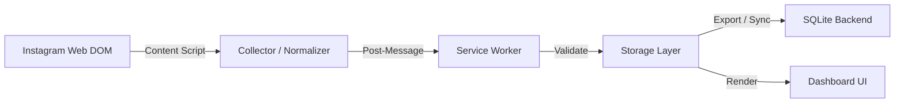

# Data Flow Architecture

This document maps the complete data lifecycle across the Brutus extension, local storage, and optional backend services.

## Lifecycle Stages

1. **Extraction (DOM):** The content script listens for modal list views, extracting raw username, full name, avatar URL, and verification status.
2. **Normalization & Sanitization:** Text fields are stripped of special whitespace characters and standard handles are extracted.
3. **Validation & State Categorization:** The validator computes confidence metrics and evaluates whether the dataset represents a trustworthy snapshot.
4. **Local Snapshot Persistence:** Snapshots are written to `chrome.storage.local` with timestamp indexing.
5. **Historical Diff Calculation:** Set differencing logic compares the active scan with the immediate predecessor to compute followers gained/lost.
